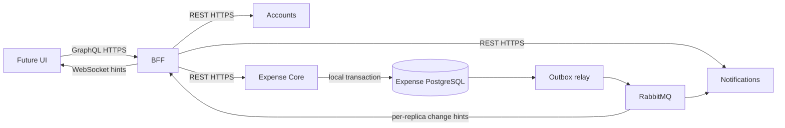

# Architecture and ownership

  

## Deployables

| Application | Modules | Authoritative data |
|---|---|---|
| Accounts | Identity linkage, profiles, preferences, lifecycle | OIDC subject mapping, profile and account settings |
| Expense Core | Groups, participants/invitations, expenses/allocation, ledger, repayments, recurrence, audit, synchronization | Every financial record, membership authorization, group revision, outbox |
| Notifications | Inbox, preferences, delivery, reminders | Inbox items, channel preferences, consumer deduplication and delivery attempts |
| BFF | Authentication adapter, REST clients, resolvers, subscriptions | No financial persistence; ephemeral connections only |

Three REST services plus a BFF are the launch boundary, not a claim that more
services imply more scale. Financial state remains together because expense,
posting, balance, audit, sync change and outbox must commit atomically. Notification
outages cannot roll back financial writes. Accounts stores general preferences;
Notifications owns channel opt-in and delivery settings, avoiding competing owners.

## Boundaries and deployment

Each service is a modular monolith in one independent Gradle application project.
Organize domain modules into `api`, `application`, `domain`, and `infrastructure`
where useful. Only published module APIs cross module boundaries. Architecture
tests prohibit cycles, domain dependencies on web/persistence adapters, and
cross-service entities/repositories. Do not create empty packages just to match a
pattern. Application services own transaction boundaries; controllers do not.

Each stateful service owns a PostgreSQL database, credentials, and one
fresh-install Flyway baseline. Databases created by the retired multi-version
chains require an explicitly approved rebuild or baseline process before this
revision is deployed. Cross-service SQL, cross-service database foreign keys,
and shared persistent domain models are prohibited. Same-service foreign keys
remain the durable referential-integrity guard; application-layer validation
(`EntityReferenceValidator` and `AccountReferenceValidator`) provides early
authorization and input errors before persistence. Hot read paths are accelerated
with bounded in-memory caching (`GroupAccessCache`, `ProfileCache`, `PreferenceCache`)
with transactional `afterCommit` invalidations, and high-volume read endpoints route to
load-balanced reader replicas via `@DbReader` and `@DbRouteContext`.
The BFF accesses only REST and event infrastructure. Shared libraries contain
technical configuration rather than business rules or service-to-service DTOs.
Fallback, retry, defaulting, and degradation behavior is catalogued in the
[fallback mechanism audit](fallback-mechanisms.md). Per-request database and cache
lookup counts and flow diagrams are catalogued in [database and cache access patterns](database-and-cache-access-patterns.md).

Clients authenticate with OIDC or passwordless login. Resource services validate signed access tokens
and enforce their own authorization; the BFF is not the security boundary. Internal
workers use scoped identities. The complete matrix, sequence flows, and event lifecycles
are documented in [Authentication and Authorization Lifecycle](../security/auth-and-authz-lifecycle.md).
Account lifecycle work must preserve attributable financial history while applying the
eventual launch-market retention policy.

REST owns commands and authoritative reads; RabbitMQ delivers committed effects.
Events carry versioned envelopes and minimal data. WebSocket notifications are
hints; snapshot/change-feed synchronization is the recoverable source. Replicas
receive independent fan-out queues, not one load-balanced notification queue.

## Inter-Service Transport & Zero-Trust Security (M-4, M-5)

In local development, internal Docker communication between the BFF and backend services
operates over internal plaintext HTTP on isolated container networks. For staging and
production deployments:
- **In-Transit TLS (M-5)**: Mutual TLS (mTLS) or container network encryption (via service mesh
  like Linkerd/Istio or sidecar proxies) is required for all traffic carrying user bearer tokens.
- **Service-to-Service Authorization (M-4)**: Downstream services validate bearer tokens
  and caller workload roles (`X-Squarewise-Workload-Role`). BFF WebClient connections utilize
  bounded timeouts, circuit breakers, and connection pools to isolate downstream degradation.

## Scale without premature decomposition

Start with stateless replicas, bounded connection pools, indexed PostgreSQL reads
and worker concurrency controls. The CQRS-oriented data-access plan in
`docs/implementation/cqrs-data-access-plan.md` defines the staged path to one
writer plus optional read replicas: writer-only commands and consistency-critical
reads, explicit query ports, causal read-after-write handling, and measured
replica promotion per capability. Reporting projections remain opt-in and
disposable; Redis, Kafka, sharding and multi-region writes remain deferred. A
million monthly users is not a workload specification: capacity claims require
measured operation mix and peaks.
